# Interview Studio · 面试工作台

一个基于 Electron + Vue 3 的 Windows / macOS 桌面应用，用于面试问答、截图作答、语音转写、简历模拟面试与 AI 题库练习。无需注册或登录本应用，模型服务由你自行配置，简历、设置和练习记录保存在本机。

当前版本：**1.5.0**。

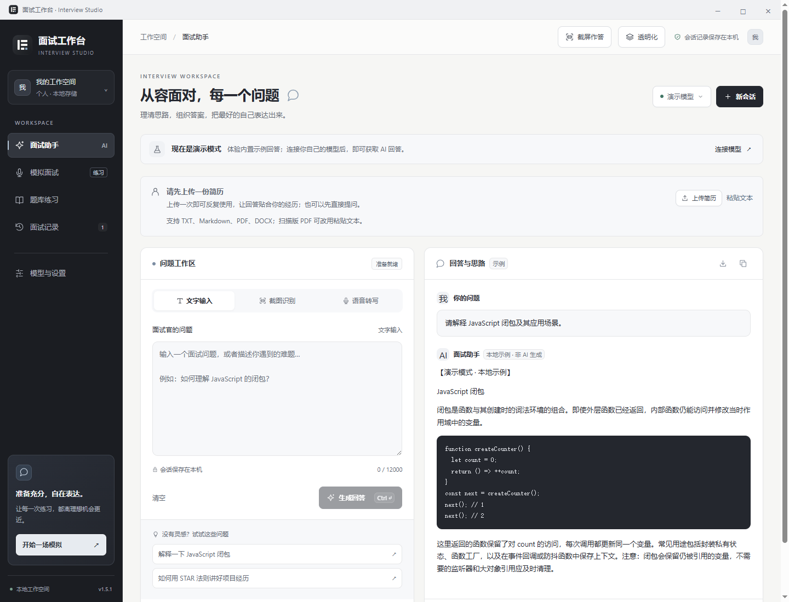

_主界面：左侧切换面试助手、模拟面试、题库练习、面试记录与模型设置。_

> 本文截图均只截取本软件窗口，使用虚构简历、示例模型配置和预设演示回答，不包含真实用户信息，也不代表某个模型服务的实际回答效果。截图中的 `localhost` 地址是文档演示接口；使用时请填写自己服务商提供的地址、模型名称与 API Key。

## 目录

- [安装与第一次使用](#安装与第一次使用)
- [配置模型](#配置模型)
- [上传简历](#上传简历)
- [设置面试偏好](#设置面试偏好)
- [文字问答](#文字问答)
- [截图作答](#截图作答)
- [语音转写](#语音转写)
- [模拟面试](#模拟面试)
- [题库练习](#题库练习)
- [面试记录与导出](#面试记录与导出)
- [透明化与桌面设置](#透明化与桌面设置)
- [快捷键](#快捷键)
- [常见问题](#常见问题)
- [开发与构建](#开发与构建)
- [上传 GitHub 时提交哪些文件](#上传-github-时提交哪些文件)
- [本地数据与隐私](#本地数据与隐私)

## 安装与第一次使用

**只使用软件，无需安装 Node.js，也不用运行开发脚本。**

1. 向维护者获取 Mac 应用 ZIP；仓库发布 Releases 后也可从 Releases 下载。当前尚未发布 Releases。
2. Apple 芯片的 Mac 双击解压 `darwin-arm64` ZIP。
3. 将 `Interview Studio.app` 拖入“应用程序”，从那里双击打开。
4. 按系统提示授予麦克风、屏幕录制权限，然后在“模型与设置”配置自己的 AI 服务。也可以先使用演示模式。

若拿到的是包含源码和应用包的完整分发文件夹，应用包位置如下：

| 系统              | 安装包位置                                          | 启动方式                                 | 详细说明                                      |
| ----------------- | --------------------------------------------------- | ---------------------------------------- | --------------------------------------------- |
| Mac（Apple 芯片） | `scripts/macos/installers/` 中的 `darwin-arm64` ZIP | 解压，将 `.app` 拖到“应用程序”，双击启动 | [Mac 使用说明](scripts/macos/README.md)       |
| Windows           | `scripts/windows/installers/` 仅预留，暂无安装包    | 等待后续提供                             | [Windows 使用说明](scripts/windows/README.md) |

Windows 本次只预留目录和脚本，不提供或验证安装包。Mac 当前包未签名公证，首次打开的处理见 Mac 说明；Intel Mac 需另行生成 x64 包。

`installers/` 是本机构建生成目录，不随 Git 提交。若你拿到的是 GitHub 源码、目录里没有安装包，请下载维护者提供的分发包或 Releases 附件。源码 ZIP 不能直接当应用运行。后续执行对应平台的打包脚本，会自动将新安装包复制到各自的 `installers/`。

安装包可由维护者放到 GitHub 仓库的 Releases 页面。当前本地提供的 Mac 包见上表；Windows 安装方式作为后续参考保留在其独立说明中。

### macOS 安装与权限

详细实现与验证范围见 [macOS 适配说明](docs/macos.md)。

- 解压 macOS ZIP，将 `Interview Studio.app` 拖到“应用程序”文件夹后打开。Apple 芯片选择 `arm64`，Intel 选择 `x64`。
- 首次录音允许访问麦克风；若曾拒绝，在“系统设置 → 隐私与安全性 → 麦克风”中开启权限。
- 首次截图按系统提示授权；若截图失败，在“系统设置 → 隐私与安全性 → 屏幕与系统音频录制”（部分系统称“屏幕录制”）中允许应用，完全退出并重新打开。开发模式对应的应用名称可能是 Electron。
- 录音功能采集麦克风，不包含会议软件的系统内部音频。
- 关闭窗口后应用保留在 Dock，点击 Dock 图标可重新打开；使用应用菜单“退出”或 `⌘ Q` 完全退出。
- macOS 的系统内容保护无法阻止所有截图：使用 ScreenCaptureKit 的软件仍可能捕获窗口。透明模式和置顶也不代表窗口一定不会被共享。
- 当前构建未配置 Developer ID 签名与 Apple 公证，正式对外分发前需要补齐。仅对可信来源的构建，按系统提供的“仍要打开”流程操作，无需关闭系统安全功能。

首次使用建议按以下顺序操作：

1. 打开“模型与设置”，在“模型管理”添加或编辑模型，保存并验证，然后选择“使用”。
2. 上传一份简历，或粘贴简历文字并保存。
3. 填写目标岗位、JD、练习重点等面试偏好，点击“保存设置”。
4. 进入“面试助手”提问，或在“模拟面试”点击“新的面试”。
5. 练习后从“面试记录”打开已有会话；题库在“题库练习”直接查看。

默认的演示模式只提供本地示例回答，适合熟悉界面。根据个人简历生成模拟面试、追加问题、评分和生成题库，需要配置可用的真实模型并关闭演示模式。

## 配置模型

### 添加、验证与切换

进入左下角“模型与设置”，找到“模型管理”。连接信息统一在这里维护，可以保存多套配置，例如日常文字问答模型和支持图片的截图模型。

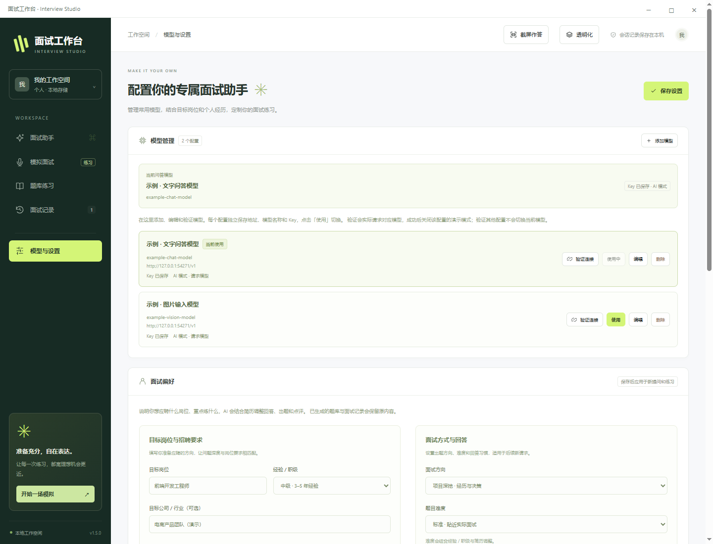

_模型管理：查看当前使用的模型，并对每个配置执行验证、使用、编辑或删除。_

1. 点击“添加模型”；已有配置也可以直接点“编辑”。
2. 填写下面四项：

| 项目         | 填写内容                                                                         |
| ------------ | -------------------------------------------------------------------------------- |
| 配置名称     | 方便自己识别的名字，例如“日常问答”或“截图识题”。                                 |
| API 服务地址 | 服务商提供的兼容接口地址。云端地址使用 HTTPS，本地 `localhost` 服务可使用 HTTP。 |
| 模型名称     | 服务商实际开放的精确模型 ID。配置名称与模型 ID 是两回事。                        |
| API Key      | 这套配置自己的凭据。新增配置不会自动借用其他模型的 Key。                         |

3. 选择保存方式。
4. 回到列表，点击需要使用的配置旁边的“使用”。带有“当前使用”标记的配置才是后续请求使用的模型。

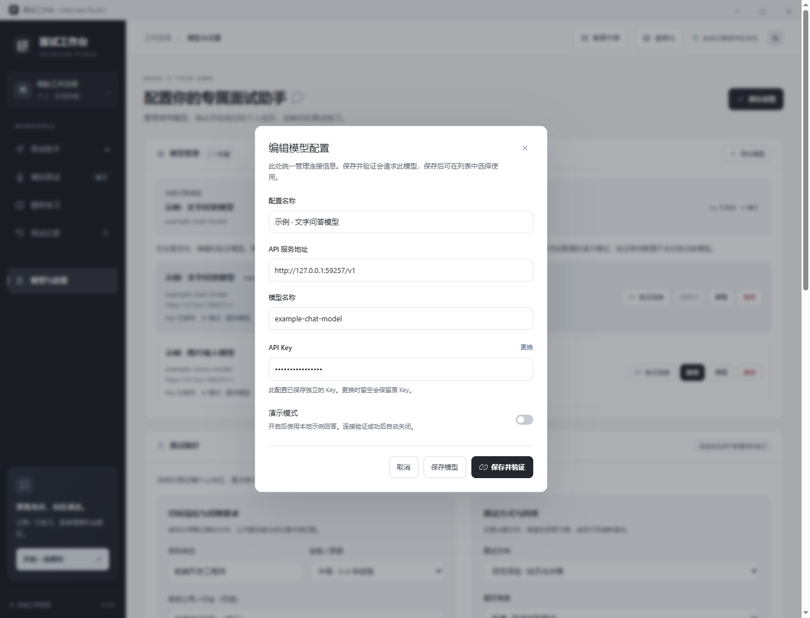

_编辑模型：填写地址、模型与 Key，再选择仅保存或保存并验证。截图中的连接信息仅为演示。_

| 操作       | 实际效果                                                                                   |
| ---------- | ------------------------------------------------------------------------------------------ |
| 保存模型   | 只保存当前配置，不发起连接验证。                                                           |
| 保存并验证 | 先保存，再实际请求该模型；验证通过后关闭这套配置的演示模式。失败时已经保存的配置仍然保留。 |
| 验证连接   | 测试列表中的对应配置。验证非当前模型不会切换当前模型。                                     |
| 使用       | 将该配置设为当前模型。新增、保存或验证其他配置不会代替这个步骤。                           |

“保存设置”负责面试偏好、语音转写和桌面设置；模型配置通过模型管理中的保存按钮独立保存。

### Key、图片能力与演示模式

- 已保存的 Key 只显示遮罩，页面不会取回真实 Key。要替换时点击“更换”，填入新的 Key 后保存；取消更换或留空保存会保留原 Key。
- 每套模型配置独立保存地址、模型名称、Key 和演示模式状态。至少保留一个配置；删除当前配置后会切换到另一个配置。
- 文字连接验证成功，只说明文字请求可用，不能据此确认模型支持图片。截图作答需选择服务商明确支持图片输入的模型。
- 应用使用兼容 `/chat/completions` 的聊天接口。API Key 的获取、额度与模型权限由你选择的服务商管理。
- 正在生成回答或处理录音、截图时，部分模型管理操作会暂时禁用，结束后再切换即可。

## 上传简历

在面试助手、模拟面试或题库练习页面找到简历提示，点击“上传简历”；也可以选择“粘贴文本”。“模型与设置”的面试偏好中也可以维护简历。

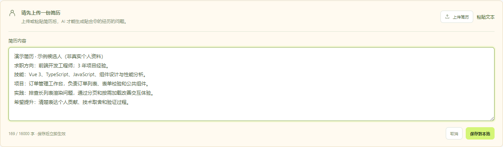

_简历入口：上传文件，或粘贴文字后保存。已有简历可继续复用。_

支持 **PDF、DOCX、UTF-8 TXT 和 Markdown** 文件，单个文件不超过 **10 MB**，提取后的简历文字最多 **16,000 字**。扫描图片版 PDF 没有可提取的文字时，需要先转成文字，或手动粘贴。

上传文件成功后，提取出的文字立即保存在本地，无需再点“保存设置”。使用粘贴入口时按提示保存；在设置页直接修改简历文字后，需要点击“保存设置”。应用保存的是提取后的文字，不会额外复制原始简历文件。

保存一次后，重新打开软件仍可使用。普通面试问答自动参考当前保存的简历；没有简历时会提示补充，但仍能提出通用问题。生成模拟面试和题库前需要先保存简历。

替换简历会影响之后的新问答、新面试和新题库批次；已有模拟面试保留创建时的简历，用于该场后续追加问题和点评。

## 设置面试偏好

打开“模型与设置”，向下找到“面试偏好”。修改后点击页面顶部的 **“保存设置”**，再开始新的提问或练习。

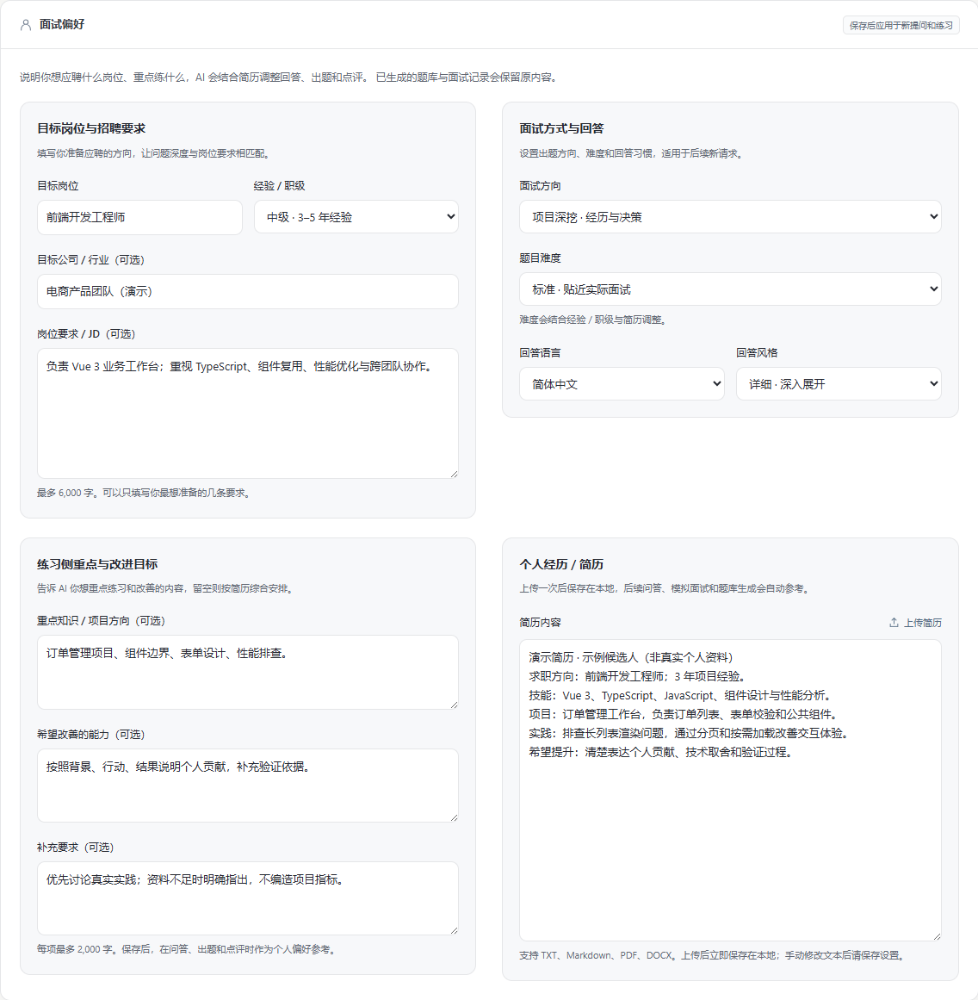

_面试偏好：填写岗位要求与练习目标，并保存后应用于后续请求。_

| 字段                | 怎么填写、会影响什么                                                                                |
| ------------------- | --------------------------------------------------------------------------------------------------- |
| 目标岗位            | 例如“高级前端工程师”，用于确定回答和出题的岗位方向。                                                |
| 经验 / 职级         | 选择在校或应届、初级、中级、高级、技术负责人等；不指定时结合简历判断。                              |
| 目标公司 / 行业     | 填写目标公司或业务领域，帮助问题贴近对应场景，可留空。                                              |
| 岗位要求 / JD       | 粘贴技能要求和职责，最多 6,000 字；AI 会参考简历与岗位要求的关联点。JD 不会被当作你已经拥有的经历。 |
| 面试方向            | 综合、技术、项目深挖或行为面试。                                                                    |
| 题目难度            | 基础、标准或挑战，并结合职级与简历调整。                                                            |
| 回答语言            | 简体中文、English 或中英双语。                                                                      |
| 回答风格            | 简洁抓重点，或详细展开。                                                                            |
| 重点知识 / 项目方向 | 例如“Vue 3、性能优化、订单系统技术选型”，最多 2,000 字。                                            |
| 希望改善的能力      | 例如“回答更有条理、说明权衡、量化成果”，最多 2,000 字。                                             |
| 补充要求            | 例如“多问实际场景，点评指出遗漏点”，最多 2,000 字。                                                 |

这些设置会实际用于**普通问答、模拟面试出题与点评、题库生成**。已有题目和点评不会因为修改设置而被重写。

模拟面试会保存本场的简历和偏好快照：**新的面试采用当前已保存设置，追加问题和继续点评沿用本场资料**。题库则按每次生成时的当前资料保存对应批次。截图快捷作答只发送截图与作答指令，不附加简历、面试偏好或历史对话。

## 文字问答

1. 进入“面试助手”，选择“文字输入”。
2. 在“面试官的问题”中输入问题。
3. 点击“生成回答”，或按 `Ctrl + Enter`。
4. 在回答区域查看内容，继续输入可在当前会话中追问。

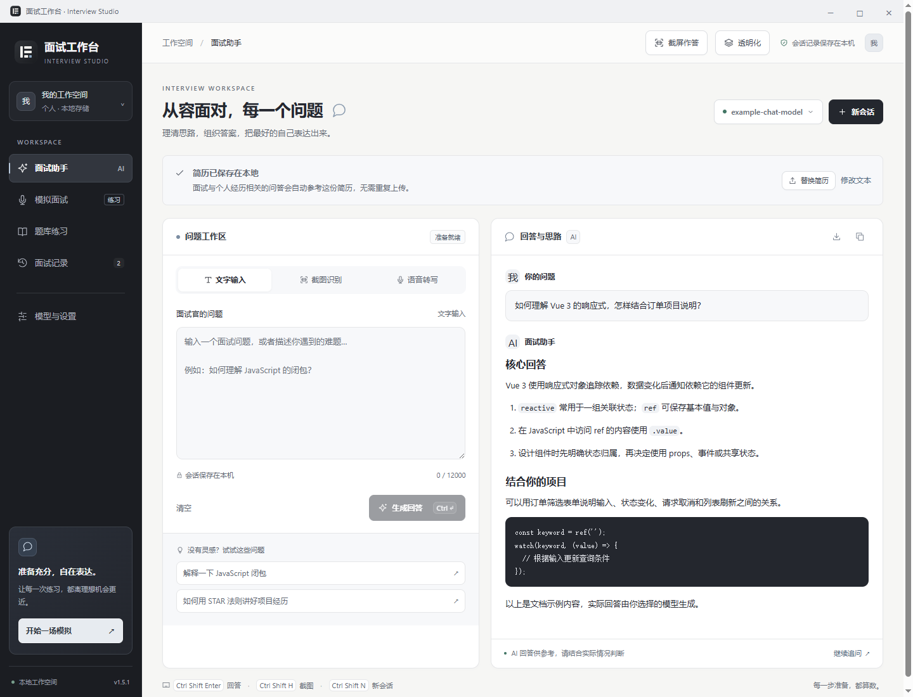

_文字问答：输入问题后生成回答，已提交的问题与回答保存在当前会话。图中内容为演示数据。_

普通问答会参考当前简历、已保存偏好和最近对话上下文。可以从回答区复制内容，或将会话导出为 Markdown；想另开话题时新建会话。清空输入框只清除当前草稿与附件，不会清空历史会话。

未发送的输入草稿主要保留在当前运行中的界面；请先提交需要保留的内容，不要把草稿当作重启后可恢复的记录。

## 截图作答

截图有两种操作方式，请根据是否需要补充文字选择。

### 一键“截屏作答”

点击顶部“截屏作答”，软件会临时收起自身，截取**软件当前所在屏幕的整屏内容**，随后恢复窗口，并直接请求当前图片模型，无需再点发送。

应用自动附加“优先只给题号和答案、不需要解析”的要求。模型没有严格遵守格式时，仍会显示返回的完整可见内容，不会因为格式不一致而把已有回答隐藏，也不会自动追加一次整理格式的模型请求。

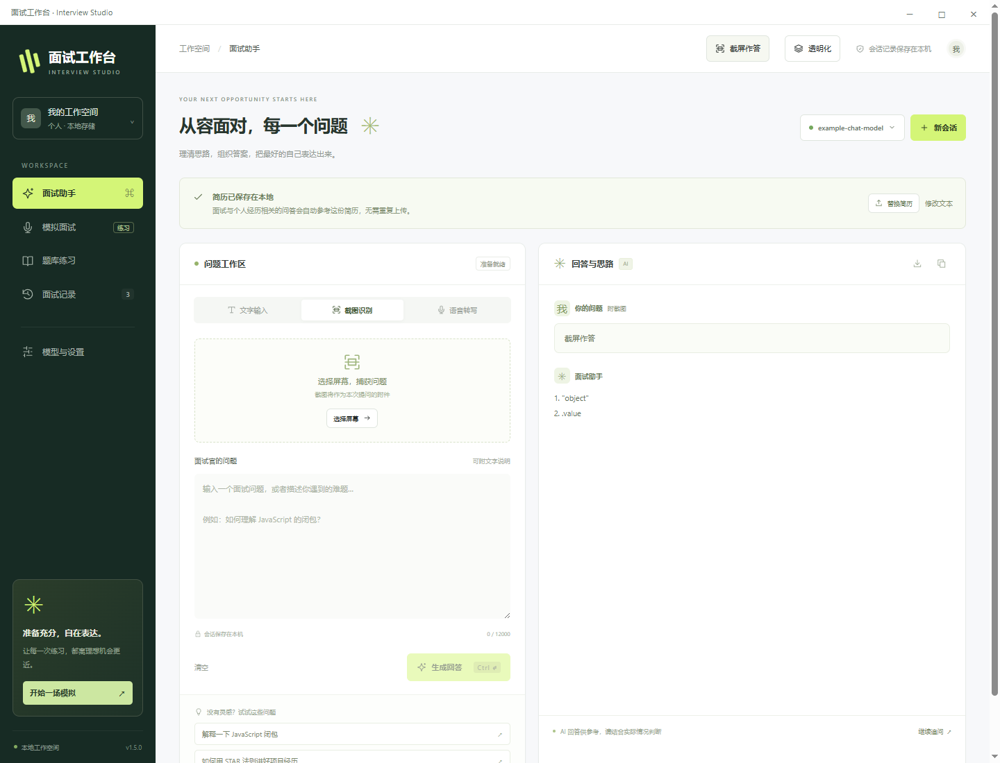

_一键作答：优先呈现题号与答案；示例回答仅用于说明显示效果。_

使用前确认当前模型支持图片输入、Key 可用、已关闭演示模式。这个按钮截取的是整屏，请先把准备分析的题目放到同一块屏幕上。

### 手动选择屏幕、预览后发送

1. 在问题工作区切换到“截图识别”。
2. 点击“选择屏幕”，多屏时选择需要的屏幕。
3. 截取后检查附件预览；不需要时点附件右上角的移除按钮。
4. 可补充文字要求，例如“只回答第 2 题”或“解释这段代码的输出”。
5. 点击“生成回答”。

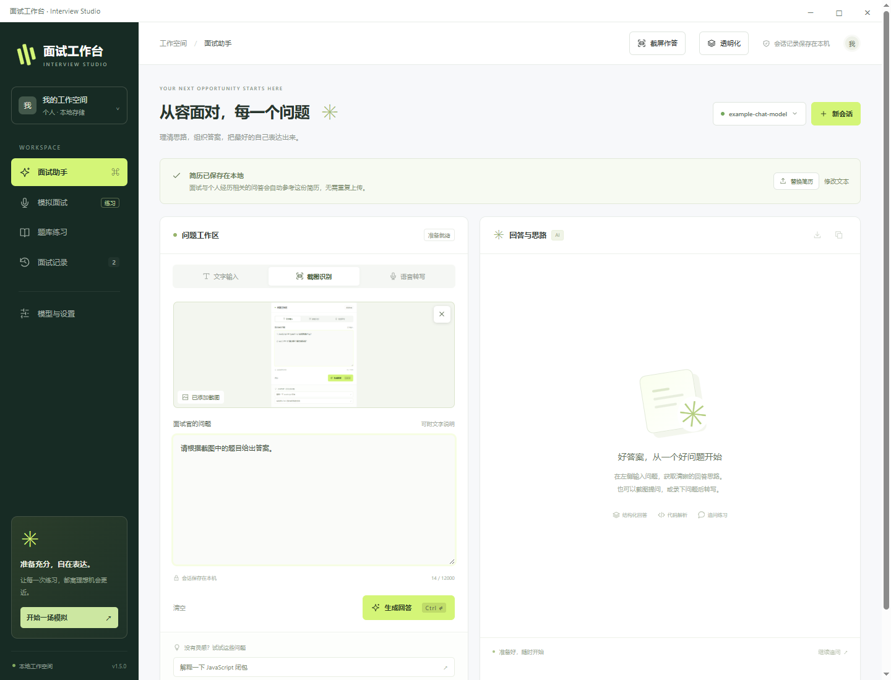

_手动截图：先预览附件，再补充文字、移除图片或发送。文档示例只展示本软件界面内容。_

手动截图和一键作答都会在截取时临时收起本软件，避免将当前工作台盖在题目上。截图只作为本次请求附件，不持久写入会话数据；识别后的文字回答会保存在会话中。

## 语音转写

语音功能是 **“开始录音 → 停止录音 → 转成文字 → 检查或修改 → 生成回答”**，不是实时监听会议或系统声音。

1. 在“模型与设置”展开“语音转写配置”。
2. 填写转写接口地址、服务商支持的转写模型和 Key，点击“保存设置”。
3. 回到面试助手，选择“语音转写”，允许使用麦克风并开始录音。
4. 点击“结束并转写”，等待转写完成，文字会填入问题输入框。
5. 检查并编辑转写结果，再点击“生成回答”。

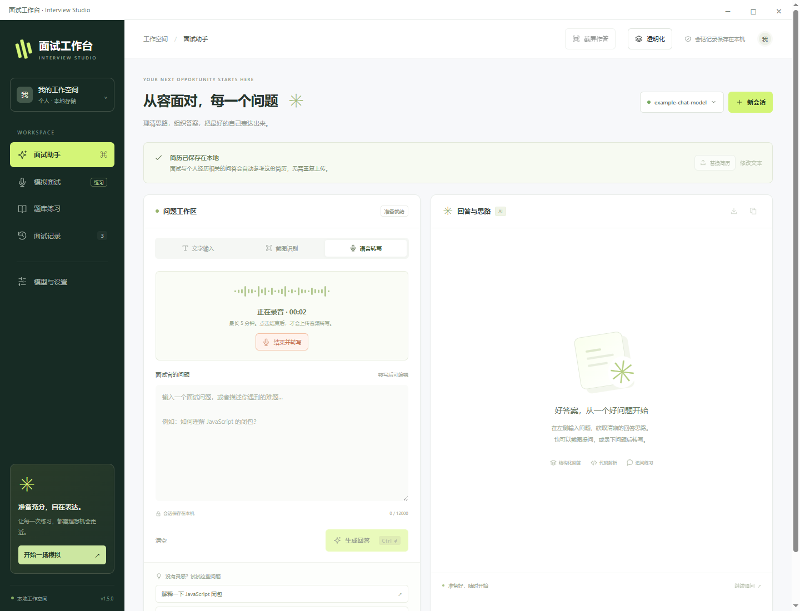

_语音入口：录音停止后才转写，转写文字可编辑后再发送。_

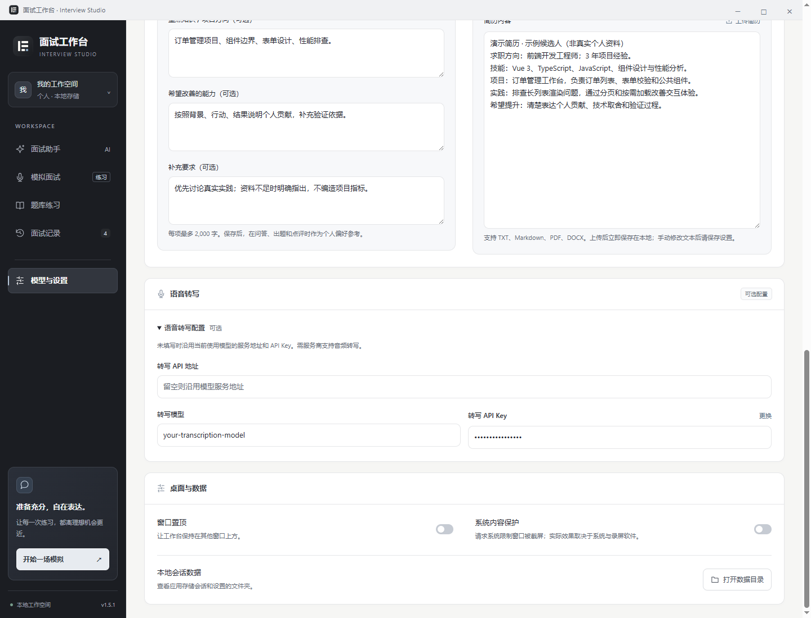

_独立转写配置与桌面选项：修改后点击顶部“保存设置”。_

转写服务需支持 `/audio/transcriptions`。地址或 Key 留空时，对应项目沿用当前模型配置；转写模型仍需填写服务商实际支持的名称，例如支持该模型的服务可使用 `whisper-1`。聊天接口可用，不代表同一服务也支持音频转写。

录制的是麦克风输入，不是电脑内部系统音频。原始音频不持久保存，停止录音后才发送给转写服务；转写内容发送提问后作为普通问题保存。

## 模拟面试

### 开始“新的面试”

1. 先保存简历、面试偏好，配置真实 AI 模型。
2. 打开“模拟面试”，选择本次 **3 / 5 / 8 题**。
3. 点击 **“新的面试”**。
4. AI 结合当前简历与偏好生成一组值得追问的问题，并保存到本场面试。

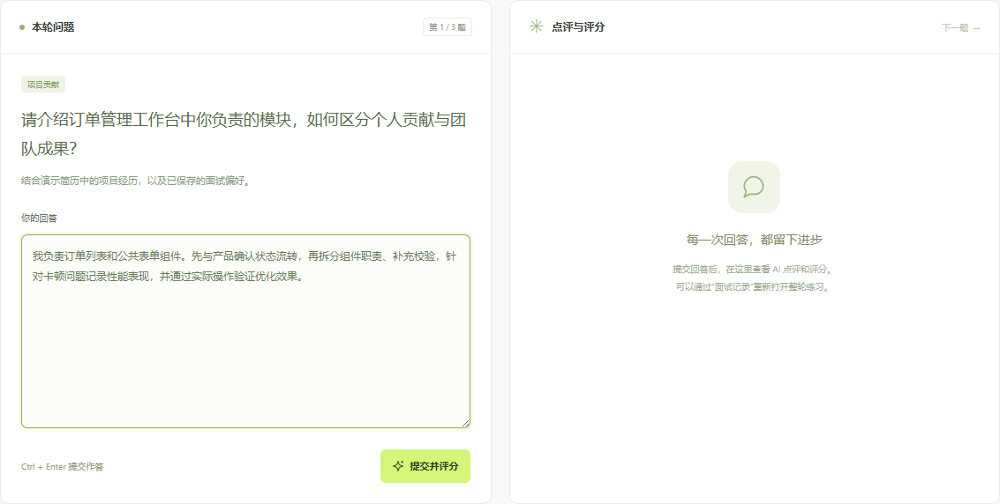

_新的面试：查看当前题目，在左侧作答，右侧逐题查看点评。_

新的面试是独立场次，以前的面试仍保留在“面试记录”，不会被覆盖。只有点击“新的面试”或“追加问题”才会请求生成问题；进入页面、查看记录和切换已有题目不会自动续生成。

### 逐题作答、点评与评分

1. 阅读当前问题，在“你的回答”中写下自己的回答。
2. 点击 **“提交并评分”**。
3. 查看点评、遗漏点与分数，再点 **“下一题”**。
4. 完成最后一题后，本场会标记完成，可到“面试记录”再次打开。

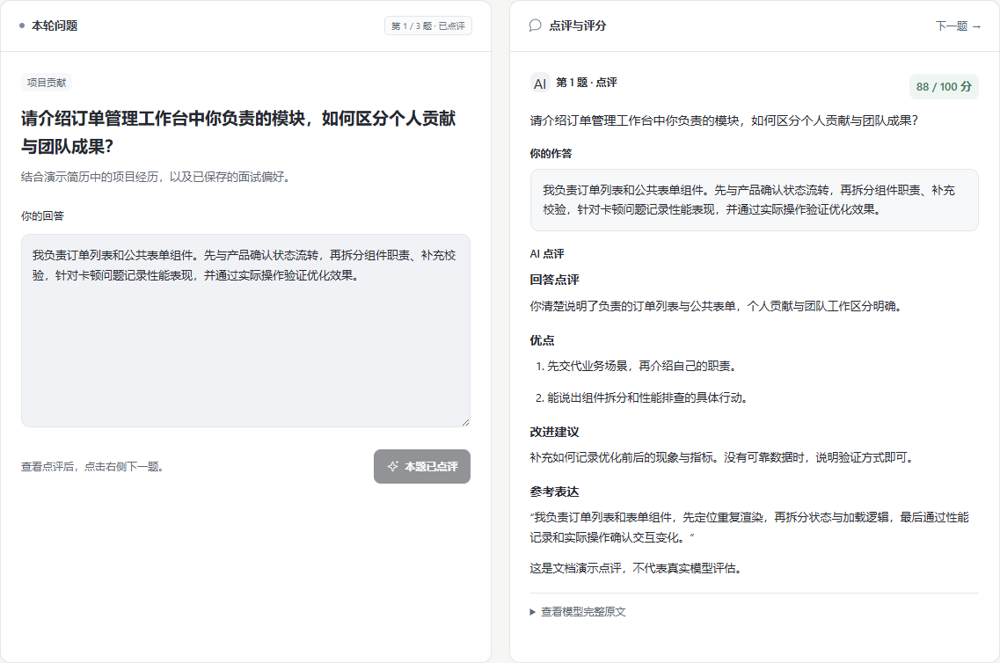

_提交后查看该题点评与分数，再继续下一题；示例分数不是对真实用户的评价。_

下一题从本场已生成的问题中选择，不会生成新题，也不能跳过尚未作答的题目。问题、已提交回答、点评、有效评分和进度会自动保存，未完成的面试可从记录中打开继续。

每次点评都会要求模型给出 **0–100 分**。如果模型没有返回有效分数，界面显示“评分未提供”，完整点评仍然保留，不会编造分数或自动追加请求。平均分只统计具有有效评分的题目。

### 在当前面试“追加问题”

想沿着同一份资料继续练习时，选择追加题数，再点击 **“追加问题”**。

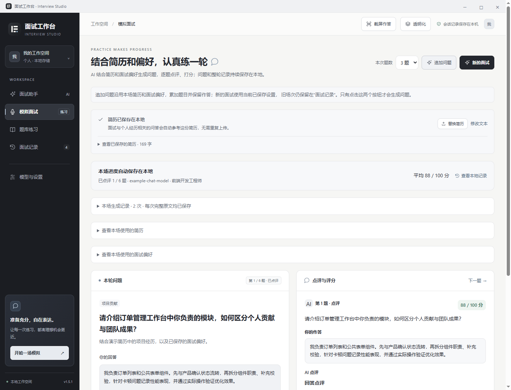

_追加问题：在当前场次末尾增加题目，旧题、回答与评分继续保留。_

追加会沿用**本场创建时保存的简历与面试偏好**，提示模型尽量避开已有问题，并把新题累加在原题后面。原题、评分、进度及当前未发送的作答草稿会保留；已经完成的场次也可以追加后继续。

如果希望使用后来修改的简历、JD 或偏好，先保存设置，再点“新的面试”。本场还可展开查看使用的简历、面试偏好，以及每次生成或追加的原始回答。模型格式不规范、没有识别出可逐题练习的问题时，原文仍会保存并显示；你可以自行选择追加或另开一场，软件不会自动重试。

## 题库练习

1. 保存简历与面试偏好，进入“题库练习”。
2. 选择每批 **5 / 10 道题**，点击“生成题库”。
3. 查看本地题目，使用关键词、分类或批次筛选。
4. 点击题目带入面试助手，需要答案时再发送。
5. 想增加新题时，点击 **“继续生成”**。

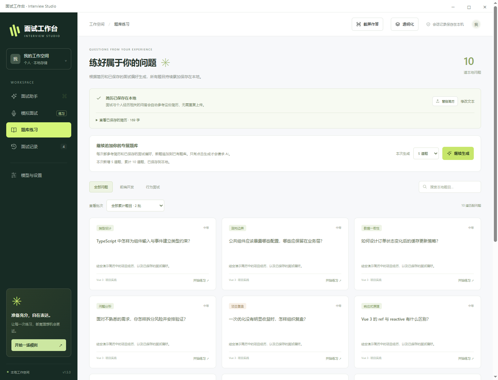

_题库：查看全部累计题目，通过分类、关键词和生成批次缩小范围。_

每次生成都会参考**当前已保存的简历和面试偏好**，在原有题库上追加一个批次。不会用新题替换旧题；生成后默认显示全部累计题目，并提示本次新增与累计数量。筛选只影响显示，不会删除题目。

只有点击生成按钮才请求模型。进入页面、搜索、切换批次和重启软件都只读取本地数据；不点“继续生成”就不会继续生成。

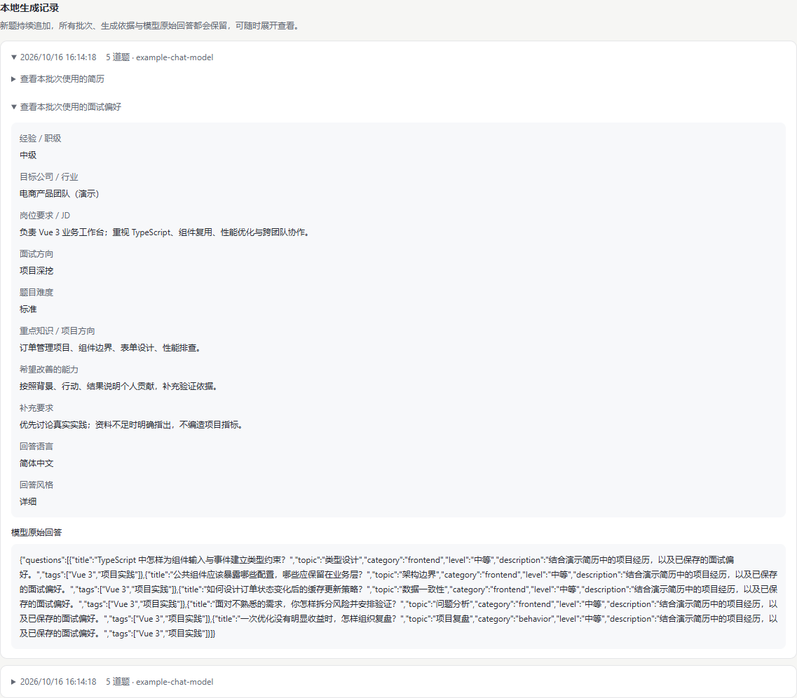

_本地生成记录：展开批次，查看当时使用的简历、偏好和模型原始回答。_

所有生成批次均保留题目、简历、偏好和原始回答。模型没有按要求返回可识别题目时，也会保留原文，已有题库继续可见。将题目带入助手后，发送时使用当前问答模型、当前简历与当前偏好；这不改变题库中保存的原始批次。

## 面试记录与导出

进入“面试记录”，可以搜索会话、重新打开普通问答或模拟面试、导出记录，或删除单条会话。

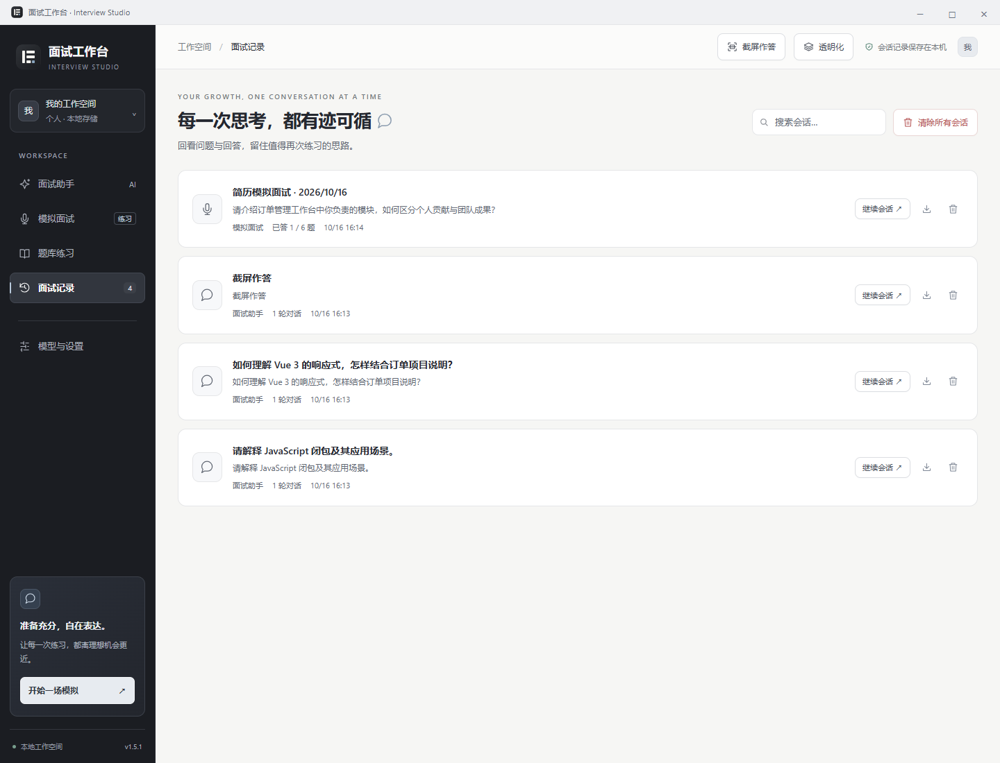

_面试记录：打开已有会话继续练习，或导出、删除需要处理的记录。_

- **打开记录**：普通会话恢复对话；模拟面试恢复已提交进度，可继续作答或追加问题。
- **导出**：保存 Markdown，便于阅读或放进笔记。导出包含该会话已写入的提问、回答及已提交的面试评分点评；不包含未作答题目、全部生成批次、简历与偏好快照，因此不是完整数据备份。
- **删除单条会话**：确认后删除所选会话。
- **清除所有会话**：确认后清空全部普通问答与模拟面试，并移除应用生成的本地聊天备份；不受当前搜索条件限制。清理后会保留一条新的空白会话供继续使用。

“清除所有会话”会保留**模型配置、API Key、当前简历、面试偏好、题库全部生成批次和透明模式偏好**。已经手动导出的 Markdown 或自行复制到其他目录的备份，由你自行管理。

完整备份方法见文末“本地数据与隐私”。未发送草稿不属于已保存的练习进度，关闭软件前请先提交需要保留的内容。

## 透明化与桌面设置

点击顶部 **“透明化”**，进入简化的悬浮界面，保留输入、历史提问、AI 回答和必要操作。左上角依次是 **“发送”“截屏作答”“恢复”**，透明模式下仍可正常问答或一键截图。

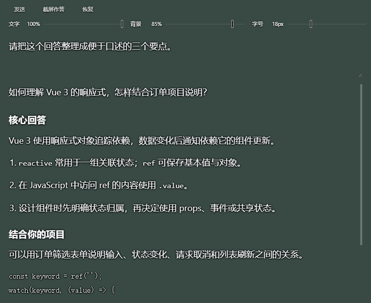

_透明模式：为便于阅读，图中背景不透明度设为 85%；实际可调到 0%，只保留文字与操作。_

三个滑块分别控制：

| 滑块 | 范围与含义                                                                     |
| ---- | ------------------------------------------------------------------------------ |
| 文字 | 文字不透明度 0%–100%。0% 不可见，100% 完全显示；按钮、标签与提示文字同步变化。 |
| 背景 | 背景不透明度 0%–100%。0% 完全透明，100% 完全不透明，与文字独立调整。           |
| 字号 | 12–32 px，调整输入、历史提问和回答的字号。                                     |

滑块使用细轨道和黑色细竖线，文字调到 0% 时竖线仍可找到。设置自动保存在本地；默认文字 100%、背景 0%、字号 16 px。切换模式会保留运行中的输入与请求，不会重新生成回答。

点击“恢复”或按 `Esc` 返回完整界面；`Ctrl + Shift + T` 切换两种模式。顶部空白区域可拖动窗口。

“模型与设置”中的“桌面与数据”还提供：

- **窗口置顶**：让工作台保持在其他窗口上方，修改后保存设置。
- **系统内容保护**：请求系统限制该窗口被采集。效果取决于 Windows 版本和共享、录屏软件，可能显示黑块，也可能直接排除窗口。透明化与内容保护是两个独立选项，不能保证在所有环境中隐身；请以共享接收端的实际画面为准。
- **打开数据目录**：打开本机保存设置与记录的文件夹。

## 快捷键

macOS 使用 `⌘ Command` 替代下表中的 `Ctrl`；`Shift`、`Enter`、`Space` 与 `Esc` 相同。全局快捷键可能与系统快捷键冲突。

| 操作                                | Windows 快捷键                           |
| ----------------------------------- | ---------------------------------------- |
| 发送当前问题 / 提交当前模拟面试回答 | `Ctrl + Enter`（应用内，按当前页面执行） |
| 选择屏幕截图                        | `Ctrl + Shift + H`                       |
| 触发回答                            | `Ctrl + Shift + Enter`                   |
| 新建会话                            | `Ctrl + Shift + N`                       |
| 显示 / 隐藏窗口                     | `Ctrl + Shift + Space`                   |
| 透明 / 完整界面                     | `Ctrl + Shift + T`                       |
| 退出透明模式                        | `Esc`                                    |

全局快捷键可能被其他应用占用，无法注册时仍可使用界面按钮。输入法处于文字确认状态时，先确认文字，再使用提交快捷键。

## 常见问题

**保存 Key 后为什么只看到一排圆点？** 这是遮罩，表示 Key 已保存，不代表内容丢失。要换 Key 点“更换”；留空保存会保留旧 Key。模型管理保存与顶部“保存设置”是不同操作。

**为什么仍然显示本地示例，或不能生成面试、题库？** 检查当前模型是否仍处于演示模式。使用“保存并验证”或“验证连接”，成功后会关闭该配置的演示模式；再确认它是“当前使用”的配置。

**文字提问正常，截图为什么失败？** 检查当前模型是否支持图片、服务是否接受图片输入。文字连接验证不验证图片能力。也可能是截图来源被系统或目标软件保护，导致图片本身发黑；先检查手动截图预览。

**截图时为什么软件会消失一下？** 截取前会临时收起本窗口，完成后恢复，避免工作台挡住题目。共享时出现黑块则可能与系统内容保护和采集方式有关。

**模型没有按题号返回，或者点评没有分数怎么办？** 非空的可见回答仍会展示。模拟面试缺少有效评分时显示“评分未提供”；生成题目格式不规范时保留原文，由你决定是否再生成，不会自动重试收费请求。

**修改偏好后，旧面试为什么还用原来的资料？** 每场面试保存自己的简历和偏好。要用新资料开启练习，保存设置后点“新的面试”；“追加问题”继续使用本场资料。

**不点“继续生成”会自动新增题库吗？** 不会。已有问题与批次保存在本地，打开页面和筛选不触发生成。

**转写失败，但聊天正常？** 确认服务支持音频转写，转写地址、模型和 Key 均有效；必要时单独配置转写服务。录音停止后才发送音频，转写完成后还需要你检查并发送问题。

**能否完全离线使用？** 可以离线查看已保存记录与题库，演示模式也使用本地示例。真实 AI 问答、生成、评分和转写需要访问你配置的接口；如果自行部署本地模型，还取决于该服务是否支持相应能力。

## 开发与构建

开发环境要求 **Node.js 22.13 或更新版本，推荐 Node.js 24**。项目的 `.node-version` 固定开发版本，可使用 fnm 自动切换。

macOS 首次配置（已安装 Homebrew）：

```bash
brew install fnm
# 将以下一行加入 ~/.zshrc，然后重新打开终端
eval "$(fnm env --use-on-cd --shell zsh)"
# 进入项目根目录后执行
fnm install
fnm use
```

在项目根目录运行：

```powershell
npm ci
npm start
```

`npm start` 会先构建 Vue 界面再打开 Electron。修改源码后重新启动即可使用更新内容。安装后的应用直接加载本地编译结果，普通用户无需运行 Vite 或安装开发依赖。

| 命令                   | 用途                                                         |
| ---------------------- | ------------------------------------------------------------ |
| `npm run build`        | 编译 Vue 界面到 `dist/renderer/`。                           |
| `npm start`            | 编译并启动桌面应用。                                         |
| `npm test`             | 运行本地模拟接口、持久化及桌面回归测试，不调用真实付费模型。 |
| `npm run format`       | 统一源码排版。                                               |
| `npm run format:check` | 检查排版。                                                   |
| `npm run make`         | 按当前平台构建：Windows 安装包/ZIP，macOS 应用 ZIP。         |

平台快捷脚本按文件夹分开，支持双击运行，也可在对应终端中执行：

| 平台    | 启动开发应用                  | 构建应用安装/分发包           |
| ------- | ----------------------------- | ----------------------------- |
| Windows | `scripts/windows/start.cmd`   | `scripts/windows/build.cmd`   |
| macOS   | `scripts/macos/start.command` | `scripts/macos/build.command` |

脚本自动定位项目根目录，无需先切换工作目录；`build` 脚本调用 `npm run make`，不是仅编译界面的 `npm run build`。Mac 脚本会加载 zsh 登录及交互配置，使用其中的 npm/fnm 环境。首次使用仍需先运行 `npm ci`；系统对下载的脚本提示安全确认时，仅对可信来源按系统提示允许。项目的启动脚本支持选择项目内的较新 Node 运行时；其他电脑仍建议先安装满足版本要求的 Node.js，再执行 `npm ci`。

主要目录：

```text
.
├─ src/
│  ├─ main.cjs                 Electron 窗口、权限、快捷键与 IPC
│  ├─ preload.cjs              桌面能力与页面之间的桥接
│  ├─ store.cjs                本地数据与凭据加密
│  ├─ renderer-protocol.cjs    提供编译后的界面与资源
│  ├─ services/                模型请求、简历解析、出题、评分与数据处理
│  └─ renderer/
│     ├─ App.vue               应用布局与页面组合
│     ├─ pages/
│     │  ├─ assistant/         文字、截图与语音问答
│     │  ├─ mock/              模拟面试与评分
│     │  ├─ library/           题库生成、筛选与批次记录
│     │  ├─ history/           会话搜索、打开、导出与删除
│     │  └─ settings/          模型、面试偏好与桌面设置
│     ├─ components/           跨页面公共组件与布局
│     ├─ composables/          会话、录音、问答与窗口等共享逻辑
│     ├─ services/desktop.js   桌面接口封装
│     └─ styles/               基础、页面、桌面与透明模式样式
├─ docs/images/               本文使用的软件窗口截图
├─ scripts/                   共享 Node.js 启动、构建及分发收集脚本
│  ├─ windows/                Windows 快捷入口、使用说明及 installers/
│  └─ macos/                  macOS 快捷入口、使用说明及 installers/
├─ tests/                     回归测试
├─ assets/                    应用图标
├─ dist/                      自动生成的界面编译产物
├─ out/                       自动生成的安装包与便携包
├─ vite.config.mjs            Vue 与 Vite 构建配置
├─ forge.config.cjs           Electron Forge 打包配置
├─ package.json               项目信息、依赖与命令
└─ package-lock.json          锁定依赖版本
```

页面专用组件与逻辑放在对应页面目录，跨页面内容放在公共组件、composables 或 services 中。源码使用两格缩进与按结构换行，格式规则见 `.prettierrc.json` 和 `.editorconfig`；不要直接修改编译产物。

运行 `npm run make` 后，1.5.0 的产物位于：

- 安装包：`out/1.5.0/make/squirrel.windows/x64/InterviewStudio-Setup.exe`。
- Windows 便携包：`out/1.5.0/make/zip/win32/x64/` 下的 ZIP。
- macOS ZIP：`out/1.5.0/make/zip/darwin/arm64/` 或 `x64/`。
- macOS 应用：`out/1.5.0/Interview Studio-darwin-架构/Interview Studio.app`。

在 Mac 上指定目标架构（Intel 构建仍需在 Intel Mac 上验证）：

```bash
npm run make -- --platform=darwin --arch=arm64
npm run make -- --platform=darwin --arch=x64
```

桌面回归测试会打开真实窗口，截图业务用例使用本地合成图片，不读取用户桌面；纯业务测试不需要真实模型账号。Mac 的麦克风授权、系统截图和多显示器表现还应进行人工验证。

安装包尚未配置商业代码签名，Windows 可能显示未知发布者；发布新版本需要重新提供安装包，当前未接入自动更新。

## 上传 GitHub 时提交哪些文件

仓库适合保存**源码、说明文档与截图**，安装包和运行数据另行管理。项目已使用 `.gitignore` 排除依赖、编译产物、打包文件、临时工具与本地数据等不适合提交的内容。

| 应提交                                  | 不提交到源码仓库                                               |
| --------------------------------------- | -------------------------------------------------------------- |
| `src/`、`scripts/`、`tests/`、`assets/` | `node_modules/`、`.tools/`、`work/` 等依赖、运行时和临时文件。 |
| `README.md`、`docs/images/`             | `dist/`、`out/`、安装包、便携 ZIP 等生成文件。                 |
| `package.json`、**`package-lock.json`** | `.env`、本地工作区数据、凭据、聊天备份与调试日志。             |
| Vite、Forge、格式配置及启动脚本         | 真实用户的简历、聊天导出和包含隐私的截图。                     |

发布可执行程序时，将安装包与便携 ZIP 上传到 GitHub 的 **Releases**，源码仓库中保留构建方法。请将 `docs/images/` 与 README 一起提交，文中的相对图片链接才能在 GitHub 正常显示。

上传前可执行：

```powershell
git status --short --untracked-files=all
git diff --cached --stat
```

确认没有真实 Key、简历、聊天记录或本地数据。`.gitignore` 只影响尚未被跟踪的文件；如果敏感文件曾被提交，需要另外处理已跟踪文件与提交历史，不能只靠新增忽略规则。

## 本地数据与隐私

**所有配置及使用记录保存在本地，无需注册或登录本应用。** 数据文件默认位于：

```text
Windows: %APPDATA%\Interview Studio\workspace.json
macOS: ~/Library/Application Support/Interview Studio/workspace.json
```

可以在“模型与设置 → 桌面与数据 → 打开数据目录”中查看。即使使用便携包，数据也保存在当前操作系统用户的数据目录中，而不是自动写在 ZIP 解压目录。

| 数据                                       | 保存或发送方式                                                                                                                                                |
| ------------------------------------------ | ------------------------------------------------------------------------------------------------------------------------------------------------------------- |
| 模型配置、API Key、面试偏好、简历文字      | 保存在本机数据文件；Key 使用 Electron safeStorage 系统加密（Windows 系统加密 / macOS 钥匙串），页面只显示遮罩。其他设置和内容为本地 JSON 数据，不是全部加密。 |
| 普通会话、模拟面试计划与评分、题库生成批次 | 保存在本机，重新打开后可继续查看。模型出题、点评时会接收对应的简历、偏好、问题和作答。                                                                        |
| 简历原始文件                               | 上传时提取文字，应用不额外复制原始文件；原文件由你自行管理。                                                                                                  |
| 普通 AI 问答                               | 必要的问题、最近上下文、当前简历与偏好发送给你配置的模型服务；附图时还会发送所选图片。                                                                        |
| 一键截屏作答                               | 发送当前屏幕图片与作答要求，不附加历史对话、简历和偏好；图片不持久保存。                                                                                      |
| 录音                                       | 停止后发送给配置的转写服务，原始音频不持久保存；转写文字提交后写入会话。                                                                                      |
| 未发送草稿                                 | 保留在当前运行界面中，不是完整持久化记录。                                                                                                                    |
| 手动导出的 Markdown                        | 保存到你选择的位置，需自行备份与删除。                                                                                                                        |

如需完整本地备份，先退出应用，再复制数据目录中的 `workspace.json` 到自己保管的位置。它包含私密简历与聊天内容，请不要提交到 GitHub。系统加密的 Key 可能受当前用户、设备或钥匙串绑定限制，迁移到其他电脑后可能需要重新填写 Key。会话 Markdown 导出便于阅读，但不能替代完整数据备份。

**无需登录，所有配置及使用记录保存在本地；启用真实 AI 时，本次请求所需的文字、简历、偏好、截图或音频仍会发送给你自行配置的模型或转写服务。本地保存不等于所有内容都不会离开设备，也不等于完全离线。**
